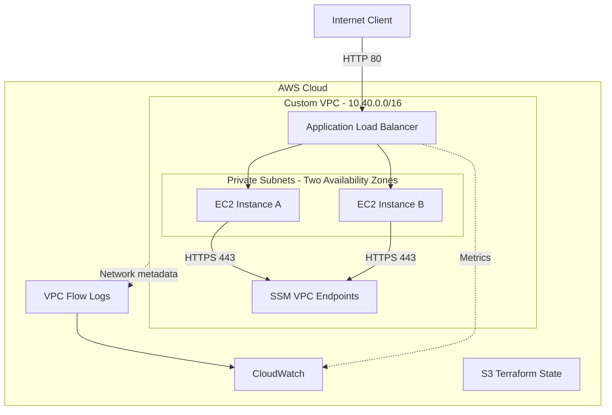

# AWS Platform Infrastructure as Code


A modular AWS infrastructure project built with Terraform, focusing on
network isolation, automated compute management, IAM security,
observability, and Infrastructure as Code validation.

## Project Overview

The goal of this project was to design and deploy a cloud infrastructure
environment using Infrastructure as Code rather than manual AWS Console
configuration.

The infrastructure includes:

- A custom VPC spanning two Availability Zones
- Public and private subnets
- An internet-facing Application Load Balancer
- EC2 instances managed by an Auto Scaling Group
- IAM roles and AWS Systems Manager access
- CloudWatch monitoring and alarms
- VPC Flow Logs
- Remote Terraform state stored in Amazon S3
- GitHub Actions CI with Terraform validation and Checkov security scanning

This project is a portfolio lab and is not intended to be a fully
production-ready deployment.

## Documentation

- [Architecture](docs/architecture.md): network addressing, traffic paths, compute, monitoring, and module dependencies.
- [Architecture decisions](docs/decisions.md): alternatives considered and the consequences of each choice.
- [Security](SECURITY.md): configured controls, Checkov baseline inventory, and production follow-up.

## Architecture



## Technologies

| Technology                | Purpose                                             |
| ------------------------- | --------------------------------------------------- |
| Terraform                 | Infrastructure provisioning and configuration       |
| AWS VPC                   | Network isolation and subnet management             |
| Amazon EC2                | Application hosting                                 |
| Auto Scaling              | Instance replacement and CPU-based scaling          |
| Application Load Balancer | HTTP traffic distribution and health checks         |
| IAM                       | Identity and access control                         |
| AWS Systems Manager       | Instance administration without public SSH          |
| Amazon S3                 | Remote Terraform state storage                      |
| CloudWatch                | Monitoring, metrics, alarms and network logs        |
| GitHub Actions            | Automated infrastructure code validation            |
| Checkov                   | Static security analysis of Terraform configuration |

## Key Design Decisions

### Private EC2 Instances

Application instances are deployed in private subnets without public IPs.

Inbound application traffic is routed through the public Application
Load Balancer.

### Systems Manager Instead of SSH

EC2 administration uses AWS Systems Manager with private VPC endpoints.

This removes the need to expose SSH port 22 to the internet.

### High Availability and Auto Scaling

The application runs in two Availability Zones.

The Auto Scaling Group maintains two instances by default and can scale
up to three instances based on CPU utilization.

### Remote Terraform State

Terraform state is stored in a versioned, encrypted S3 bucket.

S3 native state locking is enabled to reduce the risk of concurrent
state modifications.

## Monitoring

The environment includes a CloudWatch dashboard displaying:

- Healthy ALB targets
- HTTP 5XX responses
- Request count

CloudWatch alarms monitor unhealthy targets and application errors.

VPC Flow Logs collect metadata about accepted and rejected network traffic.

## CI Pipeline

GitHub Actions runs automatically on pushes and pull requests targeting
the main branch.

The pipeline performs:

1. Terraform initialization without accessing the remote backend
2. Terraform configuration validation
3. Checkov static security analysis

Checkov uses a baseline whose entries and follow-up are documented in
[SECURITY.md](SECURITY.md#static-security-analysis--checkov-baseline).
Findings outside the baseline fail CI. Changes matching an existing exception
can remain suppressed and require manual review. New findings must be assessed
individually before updating the baseline.

## Verification Evidence

All architecture and security controls have been validated against live deployments in AWS (`eu-north-1`). Detailed execution logs and sanitized command outputs are documented in [docs/evidence/runtime-verification.md](docs/evidence/runtime-verification.md).

| Check | Acceptance criteria | Recorded evidence | Status |
| --- | --- | --- | --- |
| **CI validation & security scan** | Terraform format & validation pass; Checkov static analysis passes without unexpected findings. | GitHub Actions CI run; Checkov scan (0 failures, 19 baseline skips). | **PASSED** |
| **HTTP through ALB** | ALB DNS returns HTTP 200 with application payload; targets report healthy state. | `curl -i` returned HTTP 200; target health confirmed healthy in both AZs. | **PASSED** |
| **SSM access (No SSH)** | Operator establishes session/command execution to private instances via VPC Interface Endpoints without public SSH or IP. | Verified via Systems Manager agent (Status: Online, ResponseCode: 0). | **PASSED** |
| **IMDSv2 enforcement** | IMDSv1 unauthenticated calls blocked; IMDSv2 session token call succeeds. | Verified token retrieval and metadata access via SSM script execution. | **PASSED** |
| **ASG recovery & High Availability** | Terminated EC2 instance is replaced automatically; ALB maintains uninterrupted capacity. | Forceful termination of instance triggered immediate replacement without HTTP downtime. | **PASSED** |

Full evidence logs: [Runtime Verification Log](docs/evidence/runtime-verification.md).

## Security Considerations

Implemented controls include:

- Private EC2 subnets
- Restrictive Security Groups
- EC2 IMDSv2 enforcement
- IAM roles for Systems Manager
- Private Systems Manager VPC endpoints
- S3 encryption, versioning and public access blocking
- VPC Flow Logs
- Checkov security scanning

### Known Limitations

This is a demonstration environment.

The public ALB currently uses HTTP rather than HTTPS.
AWS WAF and ALB access logging are not enabled.
CloudWatch Flow Logs use a seven-day retention period.

These limitations require additional controls before deploying
a production application handling sensitive information.

## Deployment

Prerequisites:

- AWS account and configured AWS CLI credentials
- Terraform CLI
- Permissions to create the required AWS resources

The deployment uses two Terraform configurations:

**bootstrap/**

Creates the S3 bucket used for Terraform remote state.

**environments/lab/**

Deploys the actual AWS infrastructure using reusable modules.

Example workflow:

```bash
cd bootstrap
terraform init
terraform plan
terraform apply
```

After configuring the S3 backend and environment variables:

```bash
cd ../environments/lab
terraform init
terraform validate
terraform plan
terraform apply
```

The backend bucket name and environment variables must be adjusted
when deploying to another AWS account.

## Repository Structure

```text
.
├── .github/workflows/
├── bootstrap/
├── environments/
│   └── lab/
├── modules/
│   ├── network/
│   ├── security/
│   ├── iam/
│   ├── compute/
│   ├── load_balancer/
│   └── monitoring/
├── docs/
│   ├── architecture.md
│   └── decisions.md
├── .checkov.baseline
├── SECURITY.md
└── README.md
```

## Lessons Learned

This project provided practical experience with:

- Designing public and private AWS network architectures
- Connecting reusable Terraform modules
- Managing Terraform remote state and dependencies
- Applying IAM least privilege
- Debugging infrastructure provisioning errors
- Implementing basic cloud observability
- Integrating security checks into CI pipelines

## Future Improvements

- HTTPS termination using AWS Certificate Manager
- AWS WAF integration
- ALB access logging
- Automated infrastructure testing
- Additional security and compliance controls
